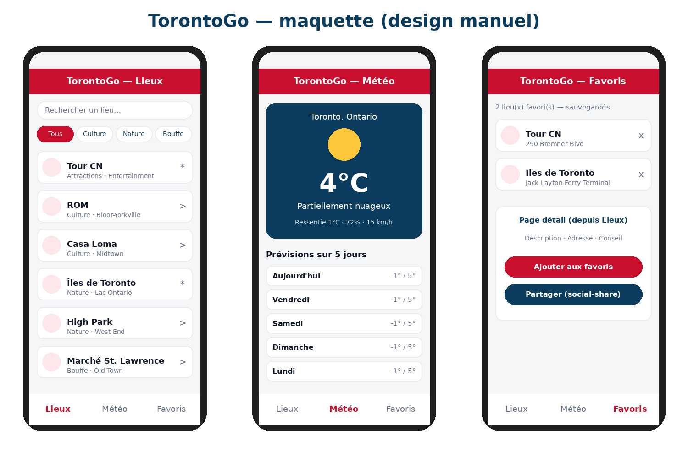
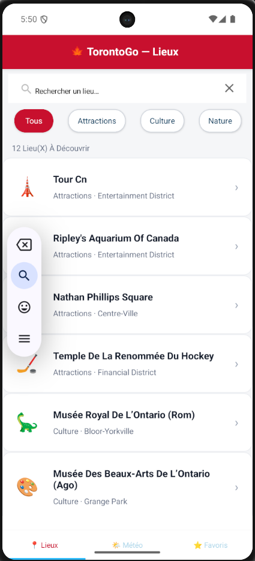
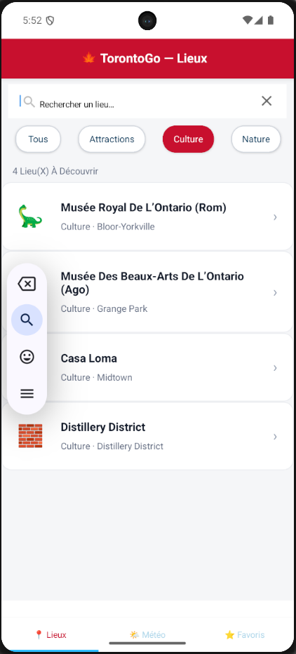
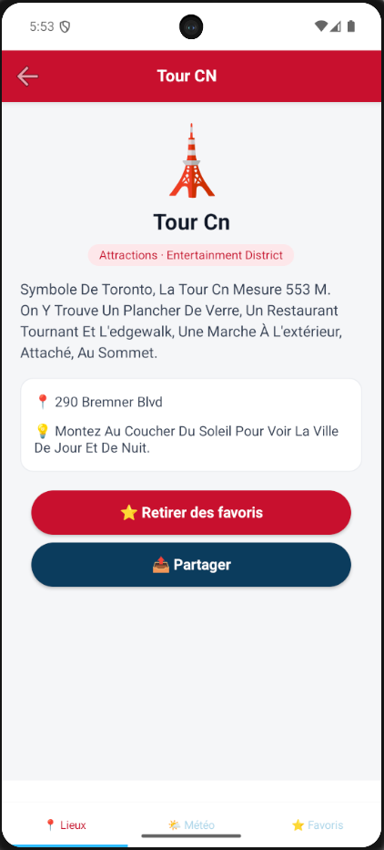
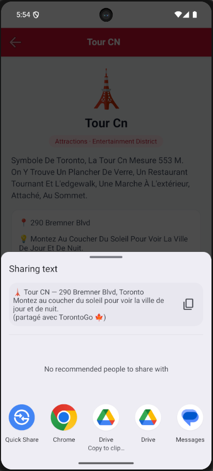
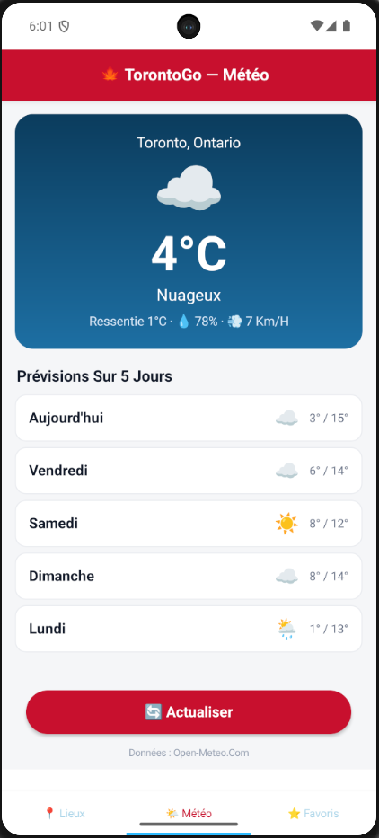
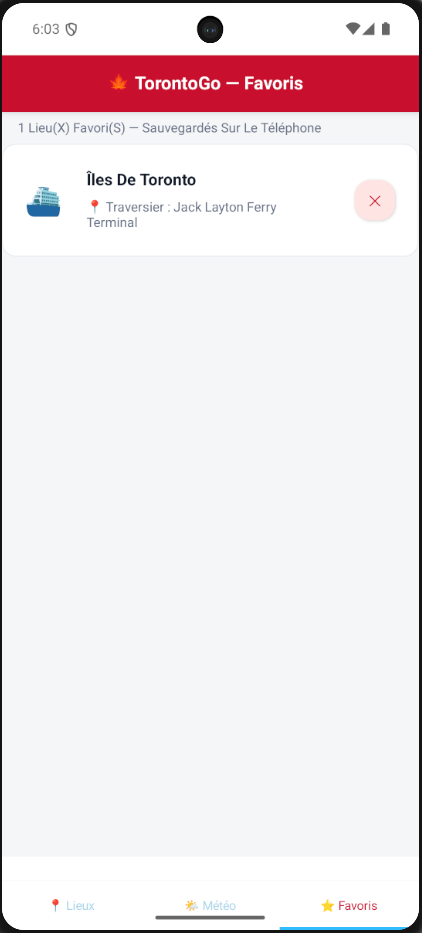

# 🍁 TorontoGo — Projet mobile INF1083

**Étudiant :** Rayan Lounis  
**Matricule :** 300157117  
**GitHub :** [lounisrayan](https://github.com/lounisrayan)  
**Cours :** INF1083 — Développement d'applications  
**Session :** Automne 2026  

---

## 📝 Résumé

**TorontoGo** est une application mobile pour **découvrir Toronto**. Elle présente les lieux incontournables de la ville (Tour CN, Musée royal de l'Ontario, Casa Loma, Îles de Toronto, Marché St. Lawrence…), avec une recherche et des filtres par catégorie. Pour chaque lieu, une page détail donne une description, l'adresse et un conseil de visite ; on peut l'**ajouter à ses favoris** ou le **partager** avec un ami.

L'application affiche aussi la **météo en direct de Toronto** (température, ressenti, humidité, vent et prévisions sur 5 jours), pour savoir quoi prévoir avant de sortir. Les favoris sont **sauvegardés sur le téléphone** et restent disponibles après la fermeture de l'application.

---

## 🎨 Design (maquette manuelle)



| Couleur | Code | Utilisation |
|---|---|---|
| 🟥 Rouge Toronto | `#C8102E` | barre du haut, boutons, filtre actif, onglet sélectionné |
| 🟦 Bleu lac Ontario | `#0B3C5D` | carte météo, bouton Partager |
| ⬜ Gris clair | `#F5F6F8` | fond des pages |

---

## 📱 Les pages (3 onglets + 1 page détail)

| # | Page | Rôle |
|---|---|---|
| 1 | **📍 Lieux** (onglet) | 12 lieux, barre de recherche (`SearchBar`), filtres par catégorie (Tous, Attractions, Culture, Nature, Bouffe), ⭐ sur les favoris |
| ↳ | **📄 Détail d'un lieu** | grand emoji, catégorie et quartier, description, adresse, conseil ; boutons **Ajouter aux favoris** et **Partager** |
| 2 | **🌤️ Météo** (onglet) | météo actuelle de Toronto et prévisions sur 5 jours (API REST, RxJS), bouton **Actualiser** |
| 3 | **⭐ Favoris** (onglet) | lieux favoris sauvegardés sur le téléphone, bouton ✕ pour retirer |

---

## 🛠️ Informations techniques

### 🧩 Template (patron)

```powershell
ns create b300157117 --template @nativescript/template-tab-navigation-ng
```

| Élément | Version / détail |
|---|---|
| Template | `@nativescript/template-tab-navigation-ng` (navigation par onglets, Angular) |
| Framework | NativeScript 9 + Angular 22 (NgModule) |
| Langage | TypeScript |
| Testé sur | Émulateur **Pixel 7 — Android 15 (API 35)** |

### 🔌 Plugins

| Plugin | Source | Utilisation dans TorontoGo |
|---|---|---|
| **`@nativescript/social-share`** | [market.nativescript.org](https://market.nativescript.org) | bouton **📤 Partager** : ouvre le menu de partage d'Android avec le nom, l'adresse et le conseil du lieu |
| **`@nativescript/theme`** | inclus dans le template | thème de base (styles des composants) |

```powershell
npm install @nativescript/social-share
```

### 🧠 Fonctionnalités NativeScript / Angular utilisées

| Fonctionnalité | Où ? |
|---|---|
| `TabView` + `page-router-outlet` (3 onglets) | `app.component.html` |
| Routage avec paramètre (`item/:id`) et `nsRouterLink` | `home-routing.module.ts`, `home.component.html` |
| `HttpClient` + **RxJS** (`pipe`, `map`, `catchError`, `subscribe`) | `shared/meteo.service.ts`, `browse.component.ts` |
| `ApplicationSettings` (sauvegarde locale) | `shared/favoris.service.ts` |
| **Signals** (`signal`, `computed`) | toutes les pages (Angular 22 *zoneless*) |
| `ListView`, `SearchBar`, `ScrollView`, `@for`, `@if` | pages Lieux, Météo, Favoris |
| Thème SCSS personnalisé | `src/_app-common.scss` |

### 🌐 API

| API | URL | Clé |
|---|---|---|
| **Open-Meteo** (météo) | `https://api.open-meteo.com/v1/forecast?latitude=43.6532&longitude=-79.3832&current=...&daily=...` | aucune (gratuite) |

---

## 📁 Structure du code

```text
7.Projects/300157117/
├── README.md
├── images/
└── b300157117/
    └── src/
        ├── _app-common.scss                ← thème TorontoGo
        └── app/
            ├── app.component.html          ← 3 onglets (TabView)
            ├── app.module.ts               ← NativeScriptHttpClientModule
            ├── shared/
            │   ├── lieu.ts                 ← modèle Lieu
            │   ├── data.service.ts         ← les 12 lieux
            │   ├── favoris.service.ts      ← favoris (ApplicationSettings)
            │   └── meteo.service.ts        ← API Open-Meteo (RxJS)
            ├── home/                       ← 📍 onglet Lieux
            │   └── item-detail/            ← 📄 page détail (favori + partage)
            ├── browse/                     ← 🌤️ onglet Météo
            └── search/                     ← ⭐ onglet Favoris
```

### Extraits du code

**Sauvegarde des favoris — `shared/favoris.service.ts`**

```typescript
const CLE = 'torontogo-favoris'

@Injectable({ providedIn: 'root' })
export class FavorisService {
  readonly ids = signal<number[]>(JSON.parse(ApplicationSettings.getString(CLE, '[]')))

  estFavori(id: number): boolean {
    return this.ids().includes(id)
  }

  basculer(id: number): void {
    const liste = this.estFavori(id) ? this.ids().filter((x) => x !== id) : [...this.ids(), id]
    this.ids.set(liste)
    ApplicationSettings.setString(CLE, JSON.stringify(liste))
  }
}
```

**Partage avec le plugin — `home/item-detail/item-detail.component.ts`**

```typescript
import { shareText } from '@nativescript/social-share'

partager(): void {
  shareText(
    `${this.lieu.emoji} ${this.lieu.nom} — ${this.lieu.adresse}, Toronto\n${this.lieu.conseil}\n(partagé avec TorontoGo 🍁)`,
    'Un lieu à visiter à Toronto'
  )
}
```

**Météo avec RxJS — `shared/meteo.service.ts`**

```typescript
getMeteo(): Observable<Meteo> {
  return this.http.get<any>(this.url).pipe(
    map((d) => ({
      temperature: Math.round(d.current.temperature_2m),
      ressentie: Math.round(d.current.apparent_temperature),
      humidite: d.current.relative_humidity_2m,
      vent: Math.round(d.current.wind_speed_10m),
      ...this.decrire(d.current.weather_code),
      jours: d.daily.time.map((date: string, i: number) => ({ /* ... */ })),
    })),
    catchError(() => throwError(() => 'Météo indisponible. Vérifiez la connexion Internet.'))
  )
}
```

**Recherche + filtre — `home/home.component.ts`**

```typescript
lieux = computed(() =>
  this.data
    .getLieux()
    .filter((l) => this.categorie() === 'Tous' || l.categorie === this.categorie())
    .filter((l) => l.nom.toLowerCase().includes(this.recherche().toLowerCase()))
)
```

---

## ▶️ Exécuter le projet

```powershell
cd 7.Projects\300157117\b300157117
npm install
ns run android
```

---

## ✅ Résultat (captures sur l'émulateur)

| 📍 Lieux | 🎭 Filtre « Culture » | 📄 Détail + favori |
|---|---|---|
|  |  |  |

| 📤 Partage (plugin social-share) | 🌤️ Météo en direct | ⭐ Favoris |
|---|---|---|
|  |  |  |

---

## ⚠️ Difficultés et solutions

| Difficulté | Solution |
|---|---|
| Angular 22 n'actualise plus l'écran automatiquement (*zoneless*) | Utilisation des **signals** (`signal`, `computed`) pour la liste, la météo et les favoris |
| Partager les favoris entre la page détail et l'onglet Favoris | Un service `FavorisService` unique (`providedIn: 'root'`) avec un signal |
| Garder les favoris après la fermeture de l'application | `ApplicationSettings` de `@nativescript/core` |
| `Application ... is not running` au premier lancement | Relancer `ns run android` |

## 🚀 Améliorations possibles

- Carte interactive des lieux (plugin `@nativescript/google-maps`)
- Position de l'utilisateur et lieux les plus proches (`@nativescript/geolocation`)
- Horaires de la TTC (transport en commun) en temps réel

---

<p align="center"><b>🍁 TorontoGo — INF1083 | 300157117</b></p>
