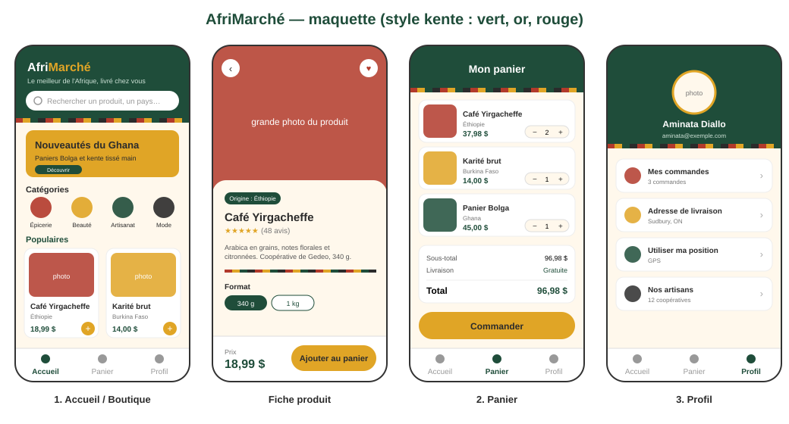

# 🌍 AfriMarché

> Projet mobile — INF1083 · Collège Boréal
> 🆔 `300157184`

## 📝 Résumé

**AfriMarché** est une application mobile (Android / iOS) de commerce en ligne qui vend uniquement des **produits 100 % africains** :
épicerie (café d'Éthiopie, bissap du Sénégal, rooibos d'Afrique du Sud…), beauté (karité du Burkina Faso, huile d'argan du Maroc…),
artisanat (paniers Bolga, masques du Mali) et mode (tissu wax, kente, bijoux maasaïs).

L'utilisateur cherche un produit par nom ou par pays et filtre le catalogue par catégorie. Sur la fiche de chaque produit, il voit
le pays d'origine, les avis et les formats offerts. Il peut ajouter un produit à ses favoris ou le partager avec ses amis. Il ajoute
ensuite des articles au panier, modifie les quantités et passe sa commande ; une notification la confirme. L'objectif est de soutenir
les artisans et les coopératives du continent africain en rendant leurs produits accessibles aux clients d'ici.

## 🎨 Design (maquette manuelle)



| Onglet / page | Rôle |
|---|---|
| 1. **Accueil** | Barre de recherche, bannière « Nouveautés du Ghana », catégories en icônes (Épicerie, Beauté, Artisanat, Mode), grille de produits avec bouton **+** d'ajout rapide |
| ↳ *Fiche produit* | Grande photo, badge d'origine, avis (étoiles), description, choix du format et de la quantité, favori ♥, partage, bouton « Ajouter au panier » |
| 2. **Panier** | Articles choisis, boutons + / −, sous-total, livraison (gratuite dès 50 $), total, bouton « Commander » |
| 3. **Profil** | Nom et courriel, menu : Mes commandes, Adresse de livraison, Utiliser ma position, Nos artisans, Mes favoris |

**Style kente** : les couleurs viennent du tissu kente du Ghana, et une bande à motif kente sépare l'en-tête du contenu.

| Couleur | Code | Utilisation |
|---|---|---|
| Vert | `#1F4D3A` | En-têtes, prix, onglet actif |
| Or | `#E0A526` | Boutons principaux, bannière |
| Rouge | `#B23A2B` | Catégorie Épicerie, favoris |
| Crème | `#FFF8EC` | Fond des pages |

## 🖱️ Prototype cliquable (HTML · CSS · JavaScript)

Le dossier [`prototype/`](prototype/) contient un **prototype interactif** de l'application, qu'on ouvre dans un navigateur.
Il simule l'application dans un cadre de téléphone : on peut chercher un produit, filtrer par catégorie, ouvrir une fiche,
choisir un format, ajouter au panier, passer une commande et remplir son profil.

| Fichier | Rôle |
|---|---|
| `prototype/index.html` | Structure des 4 écrans (Accueil, Fiche produit, Panier, Profil) et barre d'onglets |
| `prototype/style.css` | Style kente (vert, or, rouge, crème), cadre du téléphone |
| `prototype/script.js` | Catalogue, navigation entre écrans, panier, favoris, commandes, profil |

▶️ **Pour l'ouvrir :** double-clic sur `prototype/index.html`, ou dans VS Code, clic droit → *Reveal in File Explorer*, puis ouvrir avec le navigateur.

## 🧩 Patron (template)

| Template | Description |
|---|---|
| [`@nativescript/template-tab-navigation`](https://market.nativescript.org/plugins/@nativescript/template-tab-navigation) | Navigation par onglets (`TabView`) en **JavaScript**. Chaque onglet a son propre `Frame`, ce qui permet de naviguer vers la fiche produit à l'intérieur de l'onglet Accueil |

Création du projet :

```bash
ns create AfriMarche --template @nativescript/template-tab-navigation
```

## 💻 Langages

| Partie | Langage | Fichiers |
|---|---|---|
| Écrans (interface) | XML NativeScript (balises proches du HTML : `<Label>`, `<Button>`, `<StackLayout>`…) | `*.xml` |
| Logique | **JavaScript** (ES2020, modules `import` / `export`) | `*.js` |
| Style | CSS | `app.css` |

## 🔌 Plugins

| Plugin | Utilisation dans l'app |
|---|---|
| [`@nativescript/theme`](https://market.nativescript.org/plugins/@nativescript/theme) | Styles de base (marges, champs) |
| [`@nativescript/social-share`](https://market.nativescript.org/plugins/@nativescript/social-share) | Bouton de partage sur la fiche produit (SMS, WhatsApp, courriel…) |
| [`@nativescript/local-notifications`](https://market.nativescript.org/plugins/@nativescript/local-notifications) | Notification de confirmation après une commande |
| [`@nativescript/geolocation`](https://market.nativescript.org/plugins/@nativescript/geolocation) | Menu « Utiliser ma position » du Profil, pour l'adresse de livraison |

Installation :

```bash
ns plugin add @nativescript/social-share
ns plugin add @nativescript/local-notifications
ns plugin add @nativescript/geolocation
```

Modules du cœur utilisés : `ApplicationSettings` (sauvegarde du panier et du profil), `ObservableArray` (liaison de données),
`Repeater` + `WrapLayout` (grille de produits), `FormattedString`, `Dialogs`, la navigation avec `Frame`,
et un composant XML réutilisable (`components/kente.xml`) pour la bande kente.

## 🗂️ Structure

```
AfriMarche/
├── app/
│   ├── app.js / app.css / app-root.xml     # TabView à 3 onglets + style kente
│   ├── components/ kente.xml               # Bande décorative kente
│   ├── home/      home-page.xml / .js      # Onglet 1 : Accueil
│   ├── product/   product-page.xml / .js   # Fiche produit (navigation)
│   ├── cart/      cart-page.xml / .js      # Onglet 2 : Panier
│   ├── profile/   profile-page.xml / .js   # Onglet 3 : Profil
│   └── services/  store-service.js         # Catalogue, panier, favoris, commandes
├── nativescript.config.ts                  # Configuration NativeScript (fichier standard du template)
├── package.json
└── jsconfig.json
```

## ▶️ Exécution

```bash
cd AfriMarche
npm install
ns run android     # ou : ns run ios
```

> Si le dossier `App_Resources` est absent, créer un projet avec `ns create` (template ci-dessus), puis y copier le dossier `app/` et le fichier `package.json`.

## 🖼️ Captures d'écran

*(Ajouter ici les captures de l'application en exécution, dans le dossier `images/`.)*

<!--


-->
