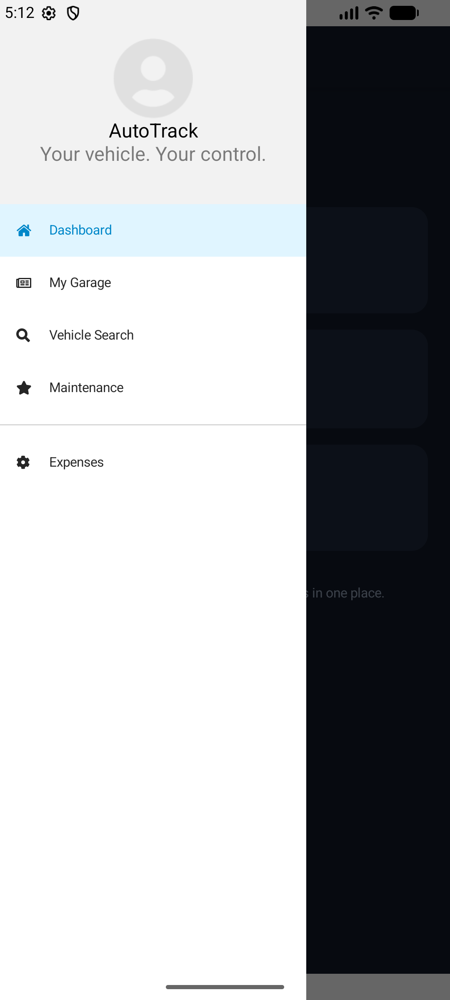
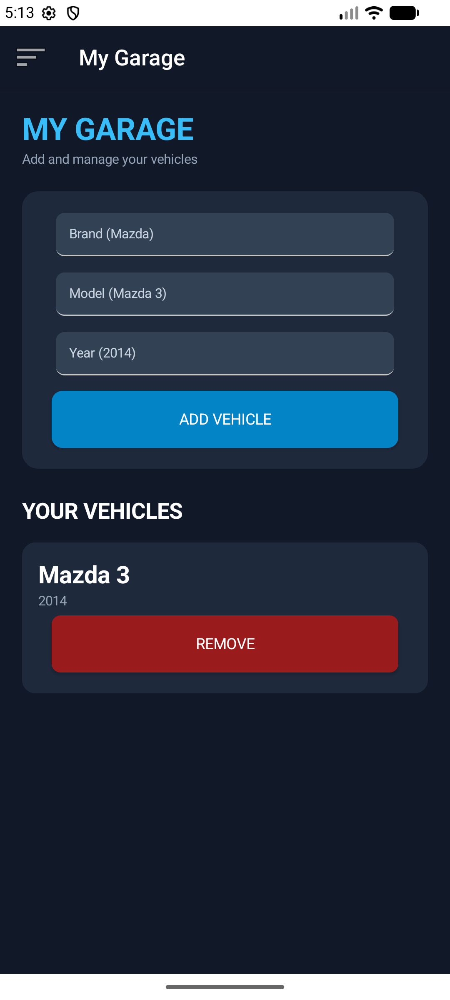
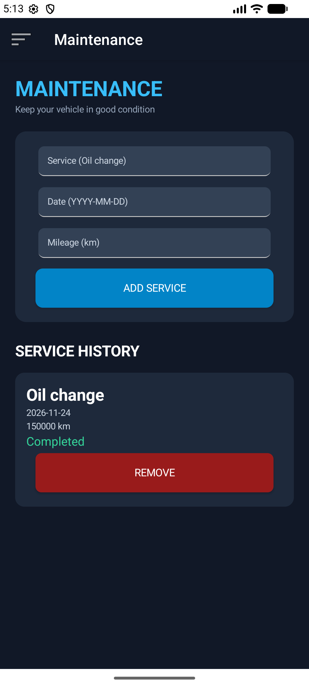
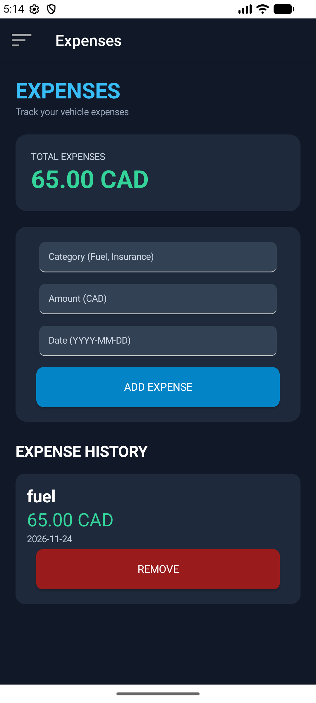
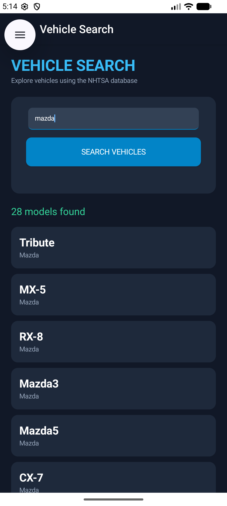
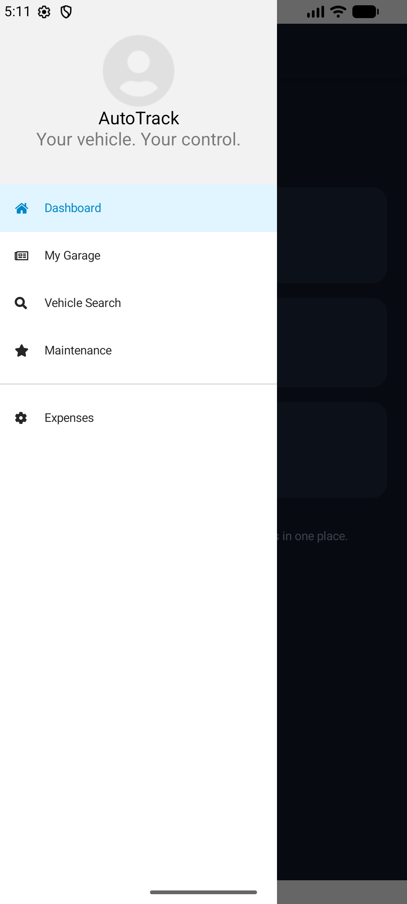

# AutoTrack - TP7 Projects

**Étudiant :** 300157275
**Cours :** INF1083 - Développement d applications

## Présentation du projet

AutoTrack est une application mobile de gestion automobile. Elle permet de gérer les véhicules, de suivre les entretiens, de contrôler les dépenses et de rechercher des modèles automobiles grâce à une API publique.

## Technologies utilisées

| Technologie | Version |
|---|---|
| NativeScript Core | 9.1.x |
| NativeScript Android | 9.1.2 |
| Angular | 22.0.x |
| TypeScript | 6.0.x |
| NativeScript Theme | ^3.1.0 |

## Template et plugins

- Template : @nativescript/template-drawer-navigation-ng
- Plugin : nativescript-ui-sidedrawer ~15.2.0
- NativeScriptFormsModule : gestion des formulaires
- ApplicationSettings : stockage local des données

## Fonctionnalités et captures

### 1. Dashboard

Tableau de bord dynamique présentant le nombre de véhicules, les entretiens en attente et le total des dépenses.



### 2. My Garage

Ajout et suppression de véhicules avec leur marque, modèle et année.



### 3. Maintenance

Gestion des entretiens, dates, kilométrages et états de réalisation.



### 4. Expenses

Enregistrement des dépenses automobiles et calcul automatique du total en dollars canadiens.



### 5. Vehicle Search

Recherche de modèles automobiles par marque avec une connexion à une API publique.



### 6. Navigation

Menu latéral permettant de naviguer entre les cinq pages.



## Connexion à une API

AutoTrack utilise l API publique NHTSA vPIC pour récupérer les modèles automobiles en temps réel au moment de la recherche.

Exemple de requête :

https://vpic.nhtsa.dot.gov/api/vehicles/getmodelsformake/mazda?format=json

La recherche Mazda a retourné 28 modèles pendant les tests. La requête utilise fetch et traite les données JSON. Un délai maximal et une gestion des erreurs sont intégrés.

## Stockage des données

Les véhicules, les entretiens et les dépenses sont enregistrés localement avec ApplicationSettings au format JSON.

## Architecture du projet

| Composant | Fonction |
|---|---|
| home | Dashboard |
| browse | My Garage |
| featured | Maintenance |
| settings | Expenses |
| search | Vehicle Search |

## Installation et lancement

```bash
cd B300157275
npm install
ns run android
```

## Tests réalisés

- Ajout d une Mazda 3 de 2014.
- Enregistrement et validation d un changement d huile.
- Ajout d une dépense de 65 CAD.
- Recherche de 28 modèles Mazda avec l API.
- Vérification des statistiques du Dashboard.
- Vérification du menu latéral.

## Conclusion

AutoTrack combine une interface mobile moderne, cinq pages fonctionnelles, un stockage local et une connexion à une API externe.
