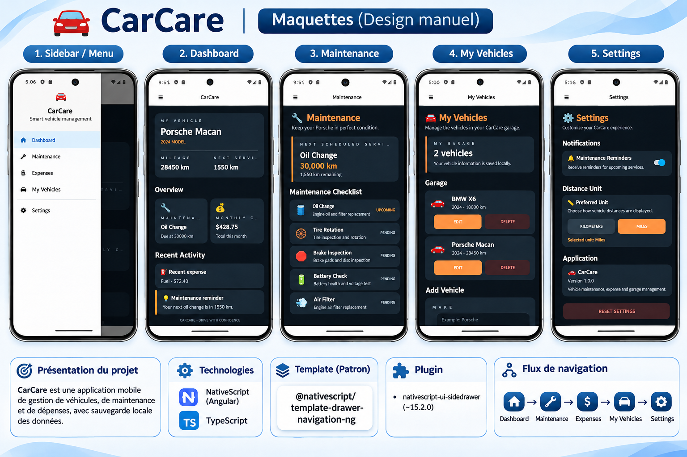
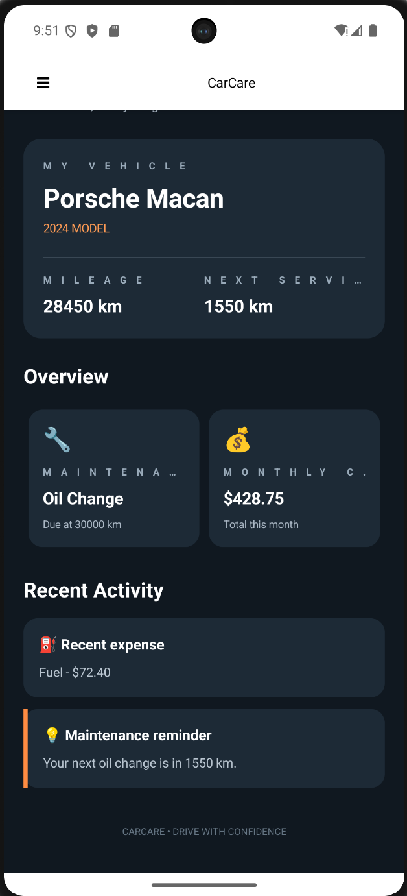
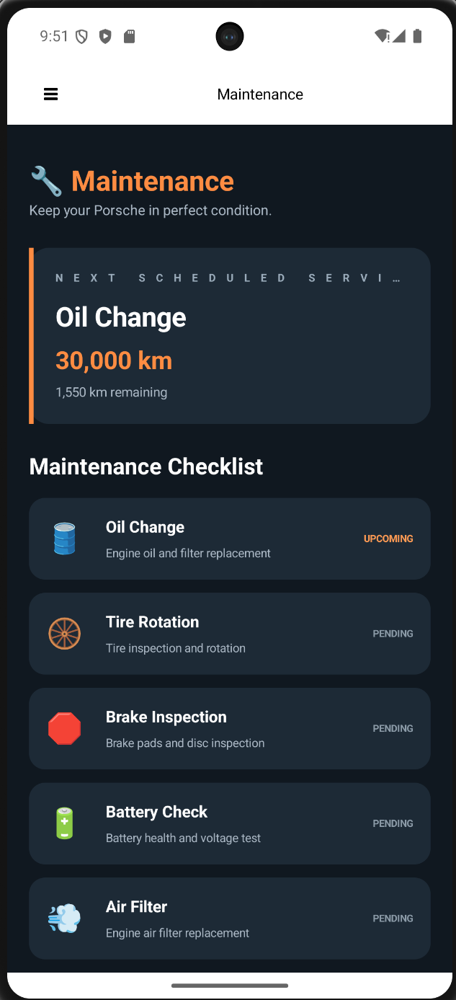
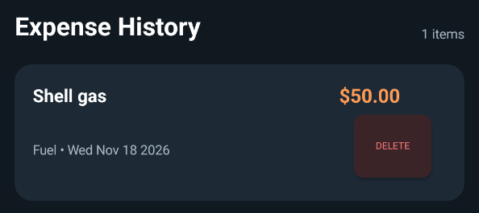
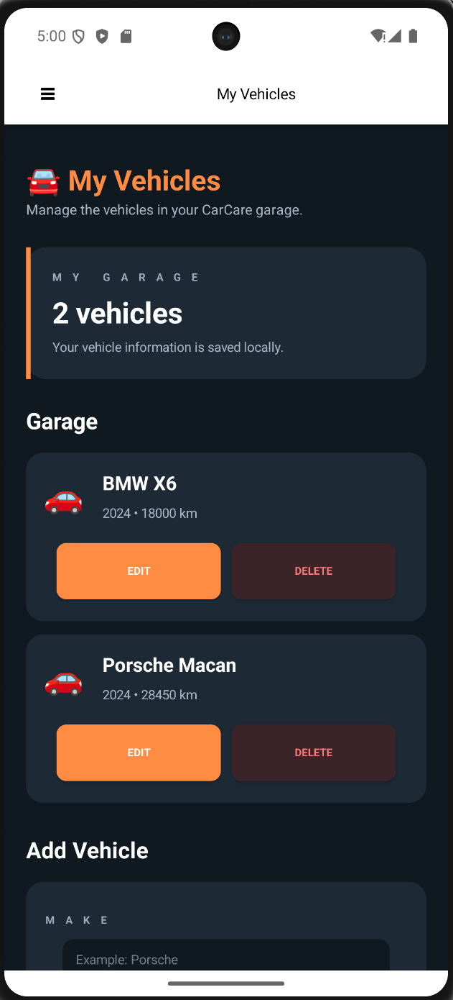
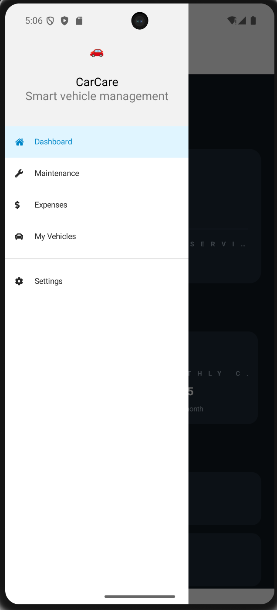
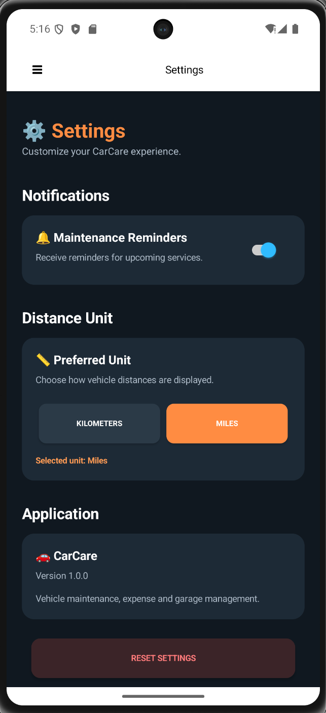

# 🚗 CarCare

**Étudiant :** MADJID BOUAMARA 
**Matricule :** 300157424
**Programme :** TSIQ — Techniques des systèmes informatiques 
**Projet :** 7.Projects  

---

## 📱 Présentation

**CarCare** est une application mobile développée avec **NativeScript et Angular** pour faciliter la gestion d'un véhicule.

L'application permet de consulter les informations principales d'un véhicule, suivre les entretiens, enregistrer les dépenses et gérer plusieurs véhicules dans un garage virtuel.

Les données importantes sont sauvegardées localement afin d'être conservées après le redémarrage de l'application.

---

## 🎯 Objectif

L'objectif du projet est de créer une application mobile fonctionnelle avec plusieurs pages accessibles à partir d'un menu de navigation.

CarCare propose notamment :

- 🚘 gestion des véhicules ;
- 🔧 suivi des entretiens ;
- 💰 gestion des dépenses ;
- 📊 tableau de bord ;
- ⚙️ préférences de l'application ;
- 💾 sauvegarde locale des données.

---

## 🎨 Maquette de l'application

Une maquette a été préparée afin de présenter l'organisation générale de CarCare, ses principales pages et son système de navigation.

La maquette présente :

- Dashboard ;
- Maintenance ;
- Expenses ;
- My Vehicles ;
- Settings ;
- navigation avec SideDrawer.



---

## 🧰 Technologies utilisées

| Technologie | Version / utilisation |
|---|---|
| NativeScript | 9.1 |
| Angular | 22 |
| TypeScript | 6 |
| RxJS | 7.8 |
| NativeScript Theme | 3.1 |
| Android Runtime | 9.1.1 |

---

## 🧩 Template utilisé

Le projet a été créé à partir du template NativeScript avec navigation par menu latéral :

```text
@nativescript/template-drawer-navigation-ng
```

Ce template permet d'utiliser un **SideDrawer** pour naviguer entre les différentes pages de l'application.

---

## 🔌 Plugin utilisé

### NativeScript UI SideDrawer

```text
nativescript-ui-sidedrawer ~15.2.0
```

Ce plugin est utilisé pour créer le menu latéral principal de CarCare.

Le menu permet d'accéder rapidement aux pages :

- Dashboard
- Maintenance
- Expenses
- My Vehicles
- Settings

---

## 🗂️ Pages de l'application

### 🏠 1. Dashboard

Le Dashboard affiche un résumé rapide de l'état du véhicule :

- véhicule principal ;
- année ;
- kilométrage actuel ;
- prochain entretien ;
- dépenses mensuelles ;
- activité récente.



---

### 🔧 2. Maintenance

La page **Maintenance** permet de consulter les entretiens importants du véhicule.

Elle présente notamment :

- Oil Change ;
- Tire Rotation ;
- Brake Inspection ;
- Battery Check ;
- Air Filter.

L'application indique également le prochain entretien et la distance restante avant celui-ci.



---

### 💰 3. Expenses

La page **Expenses** permet d'enregistrer les dépenses liées au véhicule.

L'utilisateur peut :

- ajouter une description ;
- sélectionner une catégorie ;
- entrer un montant ;
- ajouter une dépense ;
- consulter l'historique ;
- supprimer une dépense ;
- consulter le montant total.

Les catégories disponibles comprennent :

- Fuel ;
- Maintenance ;
- Insurance ;
- Repairs ;
- Other.

Les dépenses sont sauvegardées localement avec `ApplicationSettings`.

Clé utilisée :

```text
carcare_expenses
```



---

### 🚘 4. My Vehicles

La page **My Vehicles** permet de gérer les véhicules enregistrés dans CarCare.

L'utilisateur peut :

- ajouter un véhicule ;
- modifier un véhicule ;
- supprimer un véhicule ;
- enregistrer la marque ;
- enregistrer le modèle ;
- enregistrer l'année ;
- enregistrer le kilométrage.

Les véhicules restent disponibles après le redémarrage de l'application grâce au stockage local.



---

### ☰ 5. Navigation

CarCare utilise un menu latéral pour naviguer entre les différentes fonctionnalités.

Le menu contient :

- 🏠 Dashboard
- 🔧 Maintenance
- 💰 Expenses
- 🚘 My Vehicles
- ⚙️ Settings



---

### ⚙️ 6. Settings

La page **Settings** permet de personnaliser certaines préférences de CarCare.

Fonctionnalités :

- activer ou désactiver les rappels de maintenance ;
- choisir entre **Kilometers** et **Miles** ;
- sauvegarder automatiquement les préférences ;
- réinitialiser les paramètres.

Le bouton **Reset Settings** réinitialise uniquement les préférences. Les véhicules et les dépenses ne sont pas supprimés.

Les préférences sont sauvegardées avec `ApplicationSettings`.



---

## 💾 Sauvegarde locale

CarCare utilise `ApplicationSettings` de `@nativescript/core` pour conserver les données localement sur l'appareil.

Cette méthode est utilisée pour sauvegarder notamment :

- les dépenses ;
- les véhicules ;
- les rappels de maintenance ;
- l'unité de distance sélectionnée.

Cela permet de conserver les informations même après avoir fermé et relancé l'application.

---

## 🎨 Interface

L'application utilise un thème automobile sombre personnalisé.

Principales couleurs :

- fond principal : `#101820`
- cartes : `#1d2a36`
- accent orange : `#ff8c42`
- texte principal : blanc
- texte secondaire : bleu-gris

Les cartes arrondies et l'accent orange permettent de conserver une interface cohérente sur toutes les pages.

---

## 🧪 Tests réalisés

Plusieurs tests ont été effectués sur l'émulateur Android.

### 💰 Expenses

- ajout d'une dépense : ✅
- affichage dans l'historique : ✅
- calcul du total : ✅
- suppression : ✅
- conservation après redémarrage : ✅

### 🚘 My Vehicles

- ajout d'un véhicule : ✅
- modification du kilométrage : ✅
- suppression d'un véhicule : ✅
- conservation après redémarrage : ✅

### ⚙️ Settings

- changement Kilometers / Miles : ✅
- activation/désactivation des rappels : ✅
- conservation des préférences après redémarrage : ✅
- Reset Settings : ✅

### ☰ Navigation

- ouverture du SideDrawer : ✅
- navigation entre les différentes pages : ✅

---

## ▶️ Exécution

À partir du dossier du projet :

```powershell
ns run android
```

L'application est ensuite compilée et lancée sur l'émulateur Android.

---

## 📂 Structure principale

```text
300150564
│
├── B300150564
│   ├── src
│   │   └── app
│   │       ├── home
│   │       ├── browse
│   │       ├── search
│   │       ├── featured
│   │       └── settings
│   │
│   └── package.json
│
├── images
│   ├── 01-dashboard.png
│   ├── 02-maintenance.png
│   ├── 03-expenses-history.png
│   ├── 04-my-vehicles.png
│   ├── 05-navigation-menu.png
│   ├── 06-settings.png
│   └── 07-maquette-carcare.png
│
└── README.md
```

---

## 🛠️ Difficultés rencontrées

### 💾 Sauvegarde des données

Au départ, les informations ajoutées dans l'application pouvaient être perdues après un redémarrage.

**Solution :** utilisation de `ApplicationSettings` pour sauvegarder les véhicules, les dépenses et les préférences localement.

### 📝 Gestion des formulaires

Les pages Expenses, My Vehicles et Settings utilisent des champs et des contrôles liés aux propriétés Angular.

**Solution :** ajout de `NativeScriptFormsModule` dans les modules concernés.

### 📱 Interface mobile

Certains textes étaient trop longs pour l'espace disponible sur l'écran.

**Solution :** réduction de certains titres et adaptation de la mise en page pour améliorer la lisibilité.

---

## ✅ Résultat final

CarCare est une application mobile fonctionnelle comportant plusieurs pages et une navigation par menu latéral.

Le projet dépasse le minimum de **3 pages** demandé et intègre plusieurs fonctionnalités interactives : gestion des véhicules, suivi des dépenses, préférences et sauvegarde locale.

La maquette permet également de présenter clairement la conception générale et l'organisation des différentes pages de l'application.

L'application offre une interface cohérente et adaptée à la gestion quotidienne d'un véhicule.

---

**CarCare — Drive with confidence 🚗**